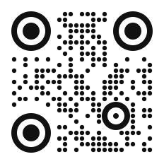

# qroid-qr

**Zero-dependency QR code generator** for **Node.js**, **React**, **React Native**, **Browser**, and **Python**.

Built by **[Qroid](https://qroid.com)** — ultra-lightweight (~15 KB npm pack), sub-millisecond SVG/ASCII, pure-stdlib PNG, and clean `square` / `round` styles.

> Need logos, frames, gradients, dynamic URLs, or scan analytics? Use the full **[Qroid Online Designer →](https://qroid.com/generate)**

---

## Generated Examples

All 4 SVG previews below are generated directly by `qroid-qr` (stored in [`./assets`](./assets)):

| `square` (default) | `round` (dots + circle eyes) | Brand colors (`level: "H"`) | Dark mode |
| :---: | :---: | :---: | :---: |
|  |  |  |  |
| `style: "square"` | `style: "round"` | `#173DA6` on `#EEF4FF` | `#F8FAFC` on `#0F172A` |

---

## Packages in this repository

| Directory | Registry | Install | Targets | Runtime deps |
| :--- | :--- | :--- | :--- | :---: |
| [`./js`](./js) | npm | `npm i qroid-qr` | Node, Browser, React, React Native, CLI | **0** |
| [`./python`](./python) | PyPI | `pip install qroid-qr` | Python ≥ 3.9, CLI | **0** |

---

## Benchmarks & Footprint

| Metric | Node.js (`js/`) | Python (`python/`) |
| :--- | ---: | ---: |
| Runtime dependencies | **0** | **0** |
| Package size | **15.4 KB** packed (51.6 KB unpacked) | **~51 KB** pure Python |
| ASCII (`256px`) | **~0.29 ms** | **~1.4 ms** |
| SVG (`256px`) | **~0.76 ms** | **~2.0 ms** |
| PNG (`256px`) | **~1.17 ms** | **~2.7 ms** |

Outputs (`svg`, `pngBuffer` / `png_bytes`, `pngBase64`, `svgBase64`, `ascii`) are **computed lazily** — reading `out.ascii` never allocates or compresses a PNG.

---

## Quick Start

### 1. Node.js

```js
import { writeFileSync } from "node:fs";
import { createQr } from "qroid-qr";

const qr = createQr("https://qroid.com", {
  style: "round",       // "square" | "round"
  size: 256,            // snapped to integer module multiple
  color: "#173DA6",     // foreground
  background: "#EEF4FF",
  padding: 2,           // quiet zone in modules
  level: "H",           // "L" | "M" | "Q" | "H"
});

writeFileSync("qr.svg", qr.svg);
writeFileSync("qr.png", qr.pngBuffer);
console.log(qr.pngBase64); // data:image/png;base64,...
```

### 2. React (Web)

```jsx
import { QrCode, useQr } from "qroid-qr/react";

export function ShareCard() {
  return (
    <QrCode
      value="https://qroid.com"
      size={192}
      style="round"
      color="#173DA6"
      background="#EEF4FF"
      level="H"
      alt="Scan to open Qroid"
    />
  );
}
```

### 3. React Native

Requires `react-native-svg` as peer dependency (`npm i react-native-svg`).  
Use `shape` (or `qrStyle`) for `"square" | "round"` — `style` stays the standard RN View style prop.

```jsx
import { QrCode } from "qroid-qr/react-native";

export function TicketQr() {
  return (
    <QrCode
      value="https://qroid.com"
      size={200}
      shape="round"
      color="#111111"
      background="#ffffff"
    />
  );
}
```

### 4. Browser (Vanilla JS)

```js
import { createQr } from "qroid-qr/browser";

const { svgDataUrl } = createQr("https://qroid.com", {
  style: "round",
  size: 200,
});
document.querySelector("#qr-img").src = svgDataUrl;
```

### 5. Python

```python
from pathlib import Path
from qroid_qr import create_qr

qr = create_qr(
    "https://qroid.com",
    style="round",        # "square" | "round"
    size=256,
    color="#173DA6",
    background="#EEF4FF",
    padding=2,
    level="H",            # "L" | "M" | "Q" | "H"
)

Path("qr.svg").write_text(qr.svg, encoding="utf-8")
Path("qr.png").write_bytes(qr.png_bytes)
print(qr.png_base64)      # data:image/png;base64,...
```

---

## CLI & Terminal ASCII

Both Node (`npx qroid-qr`) and Python (`python -m qroid_qr` / `qroid-qr`) expose the same CLI:

```bash
# Print terminal QR
npx qroid-qr "qroid.com" --ascii

# Save styled SVG + PNG
npx qroid-qr "https://qroid.com" --style round --color "#173DA6" --background "#EEF4FF" --level H --svg qr.svg --png qr.png
```

Generated compact Unicode output (`qroid.com` — true 1:1 square aspect ratio, scannable in dark terminals):

```text
█████████████████████████
██ ▄▄▄▄▄ █▀▀▄▄ █ ▄▄▄▄▄ ██
██ █   █ ██ ▄▄▀█ █   █ ██
██ █▄▄▄█ █▄ ▀█ █ █▄▄▄█ ██
██▄▄▄▄▄▄▄█▄█ ▀ █▄▄▄▄▄▄▄██
██▄▀▄█▄▀▄██ ▄▄██▀▀ ▀█▄▀██
██▀▄▀█  ▄▄█▄▄█▄▄█▄ ██▄▄██
██▄▄▄▄█▄▄▄▀█▀▀▄█▀▀ █▀█ ██
██ ▄▄▄▄▄ ██▀▄ ▀ ▄  ▄█▄▄██
██ █   █ █▄▄▄▄██  ▀▀▀▀███
██ █▄▄▄█ █▄█▀█▄█▀▀▄▄▄▀▄██
██▄▄▄▄▄▄▄█▄▄██▄█▄▄▄██▄▄██
█████████████████████████
```

---

## Options Reference

| Option | Default | Description |
| :--- | :--- | :--- |
| `style` / `shape` | `"square"` | `"square"` (classic blocks) or `"round"` (dots + concentric circle eyes). Note: React Native component uses `shape` / `qrStyle`. |
| `size` | `256` | Target pixel width/height (`64`–`2048`), snapped to nearest integer multiple of QR modules for crisp rendering. |
| `color` / `foreground` | `"#111111"` | Foreground hex color (`#rgb` or `#rrggbb`). |
| `background` | `"#ffffff"` | Background hex color (`#rgb` or `#rrggbb`). |
| `padding` / `border` | `2` | Quiet zone in modules (`0`–`16`). |
| `level` / `ecc` | `"M"` | Error correction: `"L"` (7%), `"M"` (15%), `"Q"` (25%), `"H"` (30%). |
| `mask` | `0` | `0`–`7` fixed mask (fast default) or `-1` full 8-mask penalty scan. |

---

## License

MIT © [Qroid](https://qroid.com) — see [LICENSE](./LICENSE). QR matrix encoder adapted from Project Nayuki / `uqr` (MIT).
