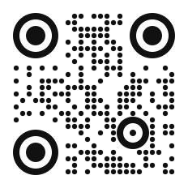
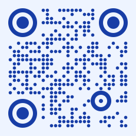

# qroid-qr

**Zero-dependency QR code generator** for **Node.js**, **React**, **React Native**, and **Browsers**.

- **2 clean styles**: `square` & `round` (dots + concentric circle eyes)
- **Zero runtime dependencies** (~15 KB packed — PNG encoded via built-in `node:zlib`)
- **Fast & lazy**: ~0.3 ms ASCII, ~0.8 ms SVG, ~1.2 ms PNG — only computes the output you read
- **Subpath exports**: `qroid-qr`, `qroid-qr/react`, `qroid-qr/react-native`, `qroid-qr/browser`

Built by **[Qroid](https://qroid.com)** · Need logos, frames, dynamic QR codes, or scan analytics? **[Open Qroid Designer →](https://qroid.com/generate)**

---

## Generated Examples

| `square` | `round` | Brand (`#173DA6`) | Dark mode |
| :---: | :---: | :---: | :---: |
|  |  |  |  |

---

## Install

```bash
npm install qroid-qr
```

For React Native only, also install the SVG peer:

```bash
npm install react-native-svg
```

---

## Entry Points

| Import | Environment | Outputs / Exports |
| :--- | :--- | :--- |
| `qroid-qr` | Node.js ≥ 18 | `createQr` → `svg`, `svgBase64`, `svgDataUrl`, `pngBuffer`, `pngBase64`, `ascii` |
| `qroid-qr/browser` | Browser / Edge / Workers | `createQr` → `svg`, `svgBase64`, `svgDataUrl`, `ascii` (no `node:zlib`) |
| `qroid-qr/react` | React ≥ 17 (Web / SSR) | `<QrCode />`, `useQr`, `createQr` |
| `qroid-qr/react-native` | React Native + Expo | `<QrCode />`, `useQr`, `createQr` |

---

## Usage Examples

### Node.js — SVG, PNG Buffer, Base64 & ASCII

```js
import { writeFileSync } from "node:fs";
import { createQr } from "qroid-qr";

// 1) Branded round QR
const brand = createQr("https://qroid.com", {
  style: "round",
  size: 256,
  color: "#173DA6",
  background: "#EEF4FF",
  padding: 2,
  level: "H",
});

writeFileSync("qr-brand.svg", brand.svg);
writeFileSync("qr-brand.png", brand.pngBuffer);

// 2) Data URL for HTML / emails
console.log(brand.pngBase64); // data:image/png;base64,...

// 3) Instant terminal preview (~0.3ms, skips PNG/SVG)
console.log(createQr("qroid.com", { padding: 1 }).ascii);
```

### React (Web / Next.js)

```jsx
import { QrCode, useQr } from "qroid-qr/react";

export function QrBadge() {
  return (
    <QrCode
      value="https://qroid.com"
      size={192}
      style="round"
      color="#173DA6"
      background="#EEF4FF"
      level="H"
      alt="Qroid QR code"
      className="rounded-xl"
    />
  );
}

// Headless hook for custom markup / download links
export function DownloadableQr({ url }) {
  const qr = useQr(url, { style: "round", size: 512 });
  return (
    <a href={qr.svgDataUrl} download="qr.svg">
      
    </a>
  );
}
```

### React Native / Expo

> On React Native, pass `shape="round"` (or `qrStyle="round"`) so `style` remains free for standard React Native layout styles.

```jsx
import { View } from "react-native";
import { QrCode } from "qroid-qr/react-native";

export function PassScreen() {
  return (
    <View style={{ alignItems: "center", padding: 24 }}>
      <QrCode
        value="https://qroid.com"
        size={220}
        shape="round"
        color="#111111"
        background="#ffffff"
        style={{ borderRadius: 16 }}
      />
    </View>
  );
}
```

### Vanilla Browser

```js
import { createQr } from "qroid-qr/browser";

const qr = createQr("https://qroid.com", {
  style: "square",
  color: "#F8FAFC",
  background: "#0F172A",
  size: 220,
});

document.getElementById("qr").src = qr.svgDataUrl;
```

---

## CLI

```bash
# Terminal ASCII
npx qroid-qr "qroid.com" --padding 1 --ascii

# Export files
npx qroid-qr "https://qroid.com" --style round --color "#173DA6" --svg out.svg --png out.png

# Print base64 data URL
npx qroid-qr "https://qroid.com" --style round --base64 png
```

```text
  ██████████████      ██████  ██████████████  
  ██          ██  ████    ██  ██          ██  
  ██  ██████  ██    ██████    ██  ██████  ██  
  ██  ██████  ██    ██    ██  ██  ██████  ██  
  ██  ██████  ██  ████    ██  ██  ██████  ██  
  ██          ██    ████  ██  ██          ██  
  ██████████████  ██  ██  ██  ██████████████  
                      ██████                  
  ██  ██  ██  ██    ██████        ██    ██    
    ██      ██      ██        ████████    ██  
    ██    ████████  ████  ████  ████    ████  
  ██  ██  ████                    ██          
  ████████  ██████        ██      ██      ██  
                  ██  ████    ██████  ██  ██  
  ██████████████      ████  ██████████  ████  
  ██          ██    ██  ██████  ████          
  ██  ██████  ██  ████████    ████            
  ██  ██████  ██              ████████████    
  ██  ██████  ██  ██      ██      ██████  ██  
  ██          ██      ██      ████      ██    
  ██████████████  ████    ██  ██████    ████  
```

---

## Options

| Option | Default | Notes |
| :--- | :--- | :--- |
| `style` / `shape` | `"square"` | `"square"` or `"round"` (RN component: `shape` / `qrStyle`) |
| `size` | `256` | Pixel size (`64`–`2048`), snapped to integer module multiple |
| `color` / `foreground` | `"#111111"` | Foreground hex (`#rgb` or `#rrggbb`) |
| `background` | `"#ffffff"` | Background hex (`#rgb` or `#rrggbb`) |
| `padding` / `border` | `2` | Quiet zone in modules (`0`–`16`) |
| `level` / `ecc` | `"M"` | Error correction: `"L"`, `"M"`, `"Q"`, `"H"` |
| `mask` | `0` | `0`–`7` fast fixed mask, or `-1` auto penalty search |

## License

MIT © [Qroid](https://qroid.com)
