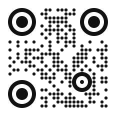

# qroid-qr

**Zero-dependency QR code generator for Python** — `square` or `round` style, custom colors, SVG, PNG, Base64, and terminal ASCII.

- **Zero external dependencies** — no `Pillow`, no `segno`, no native C compiler required (pure Python + stdlib `zlib`)
- **2 styles**: `square` (classic crisp blocks) & `round` (dots + concentric circle eyes)
- **Fast & lazy**: `svg`, `png_bytes`, `png_base64`, `svg_base64`, and `ascii` are `@cached_property` — only what you read is computed

Built by **[Qroid](https://qroid.com)** · Need logos, frames, dynamic QR codes, or scan analytics? **[Open Qroid Designer →](https://qroid.com/generate)**

---

## Generated Examples

| `square` | `round` | Brand (`#173DA6`) | Dark mode |
| :---: | :---: | :---: | :---: |
|  |  |  |  |

---

## Install

```bash
pip install qroid-qr
```

---

## Python API

```python
from pathlib import Path
from qroid_qr import create_qr

# 1) Styled round QR with brand colors
qr = create_qr(
    "https://qroid.com",
    style="round",          # "square" | "round"
    size=256,               # snapped to integer module multiple
    color="#173DA6",        # foreground hex
    background="#EEF4FF",   # background hex
    padding=2,              # quiet zone in modules
    level="H",              # "L" | "M" | "Q" | "H"
)

# Save SVG or PNG
Path("qr-brand.svg").write_text(qr.svg, encoding="utf-8")
Path("qr-brand.png").write_bytes(qr.png_bytes)

# Embed directly in HTML / JSON / FastAPI / Django templates
html_img = f''

# 2) Dark mode square QR
dark = create_qr(
    "https://qroid.com",
    style="square",
    color="#F8FAFC",
    background="#0F172A",
)
Path("qr-dark.svg").write_text(dark.svg, encoding="utf-8")

# 3) Terminal ASCII (~1.4ms — skips PNG/SVG generation)
print(create_qr("qroid.com").ascii)
```

### FastAPI / Flask endpoint example

```python
from fastapi import FastAPI, Response
from qroid_qr import create_qr

app = FastAPI()

@app.get("/qr.png")
def qr_png(url: str = "https://qroid.com", style: str = "round"):
    qr = create_qr(url, style=style, size=300)
    return Response(content=qr.png_bytes, media_type="image/png")
```

---

## CLI

```bash
# Print ASCII QR in terminal
qroid-qr "qroid.com" --ascii

# Write SVG + PNG files
qroid-qr "https://qroid.com" --style round --color "#173DA6" --background "#EEF4FF" --level H --svg qr.svg --png qr.png

# Output data URL (png or svg)
qroid-qr "https://qroid.com" --style round --base64 png
```

```text
█████████████████████████
██ ▄▄▄▄▄ █▀▀▄▄ █ ▄▄▄▄▄ ██
██ █   █ ██ ▄▄▀█ █   █ ██
██ █▄▄▄█ █▄ ▀█ █ █▄▄▄█ ██
██▄▄▄▄▄▄▄█▄█ ▀ █▄▄▄▄▄▄▄██
██▄▀▄█▄▀▄██ ▄▄██▀▀ ▀█▄▀██
██▀▄▀█  ▄▄█▄▄█▄▄█▄ ██▄▄██
██▄▄▄▄█▄▄▄▀█▀▀▄█▀▀ █▀█ ██
██ ▄▄▄▄▄ ██▀▄ ▀ ▄  ▄█▄▄██
██ █   █ █▄▄▄▄██  ▀▀▀▀███
██ █▄▄▄█ █▄█▀█▄█▀▀▄▄▄▀▄██
██▄▄▄▄▄▄▄█▄▄██▄█▄▄▄██▄▄██
█████████████████████████
```

---

## Options & Return Fields

### `create_qr(text, **options)`

| Option | Default | Notes |
| :--- | :--- | :--- |
| `style` / `shape` | `"square"` | `"square"` or `"round"` |
| `size` | `256` | Pixel size (`64`–`2048`), snapped to integer module multiple |
| `color` / `foreground` | `"#111111"` | Foreground hex (`#rgb` or `#rrggbb`) |
| `background` | `"#ffffff"` | Background hex (`#rgb` or `#rrggbb`) |
| `padding` / `border` | `2` | Quiet zone in modules (`0`–`16`) |
| `level` / `ecc` | `"M"` | Error correction: `"L"`, `"M"`, `"Q"`, `"H"` |
| `mask` | `0` | `0`–`7` fast fixed mask, or `-1` auto penalty search |

### `QrResult` attributes

- `qr.svg` → `str` (`<svg ...>...</svg>`)
- `qr.svg_base64` → `str` (`data:image/svg+xml;base64,...`)
- `qr.png_bytes` → `bytes` (raw PNG binary)
- `qr.png_base64` → `str` (`data:image/png;base64,...`)
- `qr.ascii` → `str` (compact half-block Unicode `▀ ▄ █` terminal QR)
- `qr.size`, `qr.style`, `qr.level`, `qr.padding`

## License

MIT © [Qroid](https://qroid.com)
